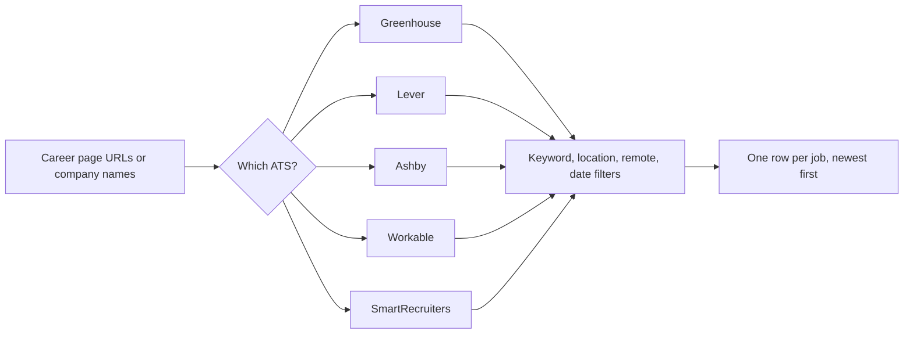

# ATS Jobs Feed: Greenhouse, Lever, Ashby, Workable and SmartRecruiters Jobs

[](https://apify.com/Turboextract/ats-job-feed)
[](LICENSE)
[](#pricing)

**Get every open job from any company's career page in one clean feed: title, department, location, remote flag, salary where listed, posted date and apply link.** Paste career page URLs or just company names. The actor finds the right board on Greenhouse, Lever, Ashby, Workable or SmartRecruiters and reads it through the board's own public JSON feed.

Most startups and tech companies post jobs on one of these five applicant tracking systems. In one test run, Airbnb had 201 open jobs on Greenhouse, Palantir 301 on Lever, Ramp 181 on Ashby with salary ranges, and Bosch 5,071 on SmartRecruiters.

**Try it now →** [apify.com/Turboextract/ats-job-feed](https://apify.com/Turboextract/ats-job-feed)

---

## Why this exists

- Most startups and tech companies post jobs on Greenhouse, Lever, Ashby, Workable or SmartRecruiters.
- Each ATS has its own public feed format, so tracking 50 companies means 5 different integrations.
- Job aggregators are days behind the company's own board, and often drop salary ranges.
- Job data APIs are sold as monthly subscriptions.

---

## Who this is for

- **Job boards and aggregators** that need fresh listings straight from the source
- **Recruiters and staffing agencies** watching target companies for new roles
- **Sales teams** using hiring as a buying signal: a company hiring 5 SDRs needs sales tools
- **Job seekers** tracking a shortlist of dream companies with a daily alert
- **Analysts** measuring hiring velocity by company, team or location

---

## What you get per job

```json
{
  "company": "Ramp",
  "ats": "Ashby",
  "title": "Senior Software Engineer, Product Foundations",
  "department": "Engineering",
  "location": "Remote (US)",
  "workplaceType": "Remote",
  "employmentType": "Full-Time",
  "salary": { "min": 204000, "max": 280000, "currency": "USD", "interval": "1 YEAR", "text": "$204K - $280K" },
  "postedAt": "2026-11-17T19:46:00.800Z",
  "url": "https://jobs.ashbyhq.com/ramp/a9cb5fd3-1acb-474e-ab7c-b811eeb5b0c2",
  "applyUrl": "https://jobs.ashbyhq.com/ramp/a9cb5fd3-1acb-474e-ab7c-b811eeb5b0c2/application",
  "remote": true
}
```

Turn on **Include full job description** to add the posting text.

---

## How it works



Each ATS publishes a public job board feed for its customers. The actor reads those feeds directly, so there are no browsers, no proxies and no blocked requests.

---

## Quick start

1. Click **Try for free**.
2. Add companies, like `airbnb`, `https://jobs.lever.co/palantir` or `https://jobs.ashbyhq.com/ramp`.
3. Optional: set **Title keywords** like `engineer`, tick **Remote jobs only**, or set **Posted in the last N days** to `1`.
4. Click **Start**, then export to CSV, JSON or Google Sheets. Schedule it daily for a new-jobs alert.

### API

```bash
curl -X POST "https://api.apify.com/v2/acts/Turboextract~ats-job-feed/run-sync-get-dataset-items?token=YOUR_TOKEN" \
  -H "Content-Type: application/json" \
  -d '{
    "companies": ["airbnb", "https://jobs.lever.co/palantir", "https://jobs.ashbyhq.com/ramp"],
    "keywords": ["engineer"],
    "postedWithinDays": 7
  }'
```

### Python

```python
from apify_client import ApifyClient

client = ApifyClient("YOUR_TOKEN")
run = client.actor("Turboextract/ats-job-feed").call(run_input={
    "companies": ["ramp", "airbnb"],
    "remoteOnly": True,
    "postedWithinDays": 1,
})
for job in client.dataset(run["defaultDatasetId"]).iterate_items():
    print(job["company"], job["title"], job["location"], job["applyUrl"])
```

---

## Input fields

| Field | Default | What it does |
|---|---|---|
| `companies` | – | Career page URLs or company names |
| `keywords` / `excludeKeywords` | – | Match or drop by job title, department or team |
| `locations` | – | Keep jobs in these places, e.g. London, Remote |
| `remoteOnly` | false | Remote jobs only |
| `postedWithinDays` | 0 (all) | Only jobs posted in the last N days |
| `departments` | – | e.g. Engineering, Sales |
| `includeDescription` | false | Add the full job text |
| `maxJobsPerCompany` | 0 (no limit) | Newest jobs first |
| `maxResults` | 1000 | Total cap per run |

---

## Pricing

**$0.003 per job delivered.** Checking 50 companies with 20 matching jobs each costs $3.

| Option | 1,000 jobs |
|---|---|
| **ATS Jobs Feed** | **$3**, five ATS platforms in one actor |
| Other ATS actors on Apify | $1 to $4, often one ATS per actor |
| Job data APIs | Monthly subscriptions |
| Checking career pages by hand | Hours a week |

---

## Common use cases

- **New-job alerts**: run daily with `postedWithinDays: 1` and send matches to Slack or email
- **Hiring signals for sales**: companies opening sales, security or data roles
- **Job board backfill**: pull every open role from hundreds of companies
- **Salary research**: Ashby and Lever boards often publish pay ranges
- **Competitive intel**: which teams your competitors are growing this quarter

---

## Tips for best results

- Paste the career page URL when the company name differs from its board slug.
- Schedule daily with `postedWithinDays: 1` for a new-jobs alert.
- Use `maxJobsPerCompany` to sample big employers without pulling thousands of rows.
- Dedupe on `ats` plus `jobId` across runs.

---

## Pairs well with

- [Workday Jobs Feed](https://apify.com/Turboextract/workday-jobs-feed): jobs from any company's myworkdayjobs career site
- [Hacker News Hiring Leads](https://apify.com/Turboextract/hn-hiring-leads): Who is hiring posts with salary, stack and email
- [Y Combinator Company Leads](https://apify.com/Turboextract/yc-company-leads): YC startups with founders, many of them hiring

---

## FAQ

**How do I find a company's board?** Paste the career page URL. If you only know the name, enter it and the actor tries all five platforms. Names that don't match the board slug, like a company that uses an abbreviation, need the URL.

**Does it support Workday?** Workday career sites are covered by the separate [Workday Jobs Feed](https://apify.com/Turboextract/workday-jobs-feed).

**How fresh is the data?** Live. Each run reads the company's current board, so a job posted a minute ago shows up.

**Is it legal?** The actor reads public job board feeds that the ATS vendors publish for exactly this purpose: showing a company's open jobs anywhere.

---

## SEO keywords

greenhouse jobs scraper, lever jobs API, ashby job board scraper, workable jobs scraper, smartrecruiters jobs API, ATS job scraper, company career page scraper, job postings API, startup jobs feed, hiring signals data

---

## Support

- Actor page: https://apify.com/Turboextract/ats-job-feed
- Issues and questions: open an issue in this repo
- Community Discord: https://discord.gg/8SrXSCpvgj

Built and maintained by [Turboextract](https://apify.com/Turboextract) on the Apify platform.

---

## License

The documentation and examples in this repository are MIT licensed. The actor itself runs on the Apify platform.
